

  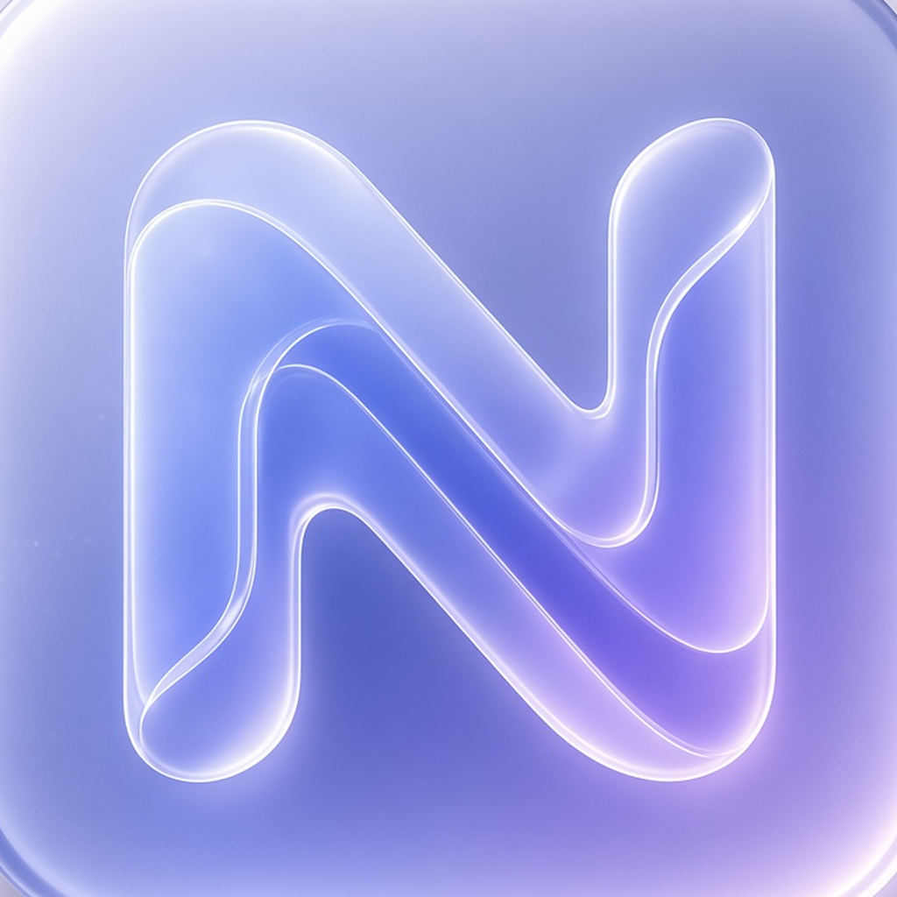

<h1 align="center">nano-notes</h1>

  Private, on-device clinical notes for therapists. 
  nano-notes turns therapy sessions into finished clinical notes on your iPhone: record the session, review the summary, and get a SOAP, DAP, BIRP or custom note in minutes. 
  It runs entirely on the phone, powered by Liquid AI's on-device models, so nothing about your clients ever leaves the device.

  <strong>Powered by <a href="https://www.liquid.ai/">Liquid AI</a> foundation models, running entirely on the iPhone.</strong>

---

## See it in action

  <video src="docs/screenshots/short_intro.mp4" width="320" controls muted playsinline poster="docs/screenshots/schedule.png"></video>

<a href="docs/screenshots/short_intro.mp4">Watch the short intro (MP4)</a>

## Powered by Liquid AI

Every AI feature in nano-notes runs on **[Liquid AI](https://www.liquid.ai/)'s LFM3-Omni-2B**, a small multimodal model that understands both speech and text. One model does everything:

- **Live transcription** — it listens to each audio chunk directly; there is no separate speech-to-text engine.
- **Summaries and clinical notes** — Session, SOAP, DAP, BIRP and your own templates.
- **Assist** — client descriptions, goals, cross-session insight and questions about a session.

Why a Liquid model:

- **Small enough for a phone.** At about 1.1 GB (4-bit) plus a 0.5 GB audio projector, it runs locally on an iPhone through llama.cpp — so session audio and notes never leave the device.
- **Light on memory for long sessions.** Liquid's hybrid architecture uses mostly short convolution blocks with only a few attention layers, so the memory needed for long contexts stays small. The model handles up to 128k tokens; nano-notes sizes the context to each job.
- **One model instead of three.** Early versions used LFM2-2.6B-Transcript for summaries and LFM3-1.7B for notes alongside the Omni model for transcription. Moving everything to LFM3-Omni-2B cut the download from 4.3 GB to 1.6 GB and removed model swapping.

The model is downloaded once from Hugging Face ([LiquidAI/LFM3-Omni-2B-GGUF](https://huggingface.co/LiquidAI/LFM3-Omni-2B-GGUF)) and used under the LFM Open License v1.0.

## What it does

nano-notes is an iPhone app for therapists. It records a session, transcribes it live, writes a summary you can edit, and then writes the clinical note in the format you pick (Session, SOAP, DAP, BIRP or your own templates). All of it runs on the phone with a local AI model: no cloud transcription, no server, no account.

  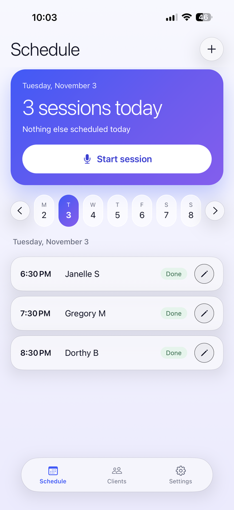
  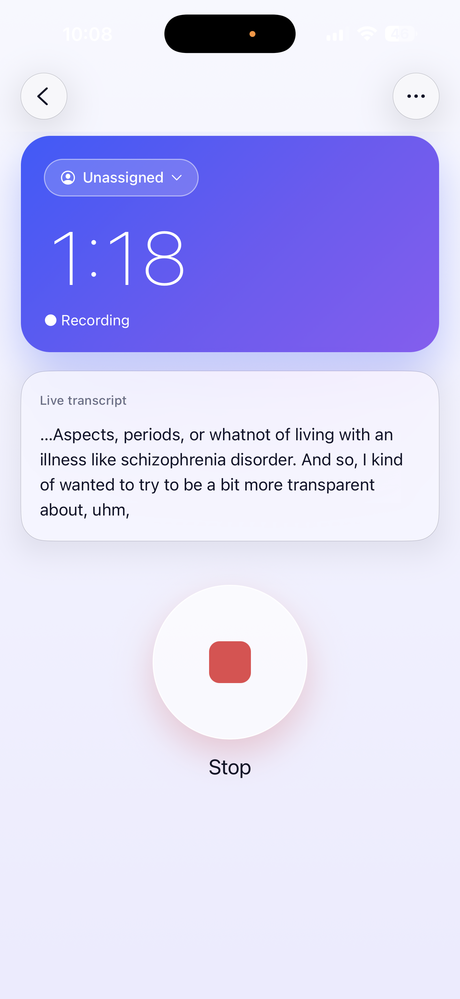
  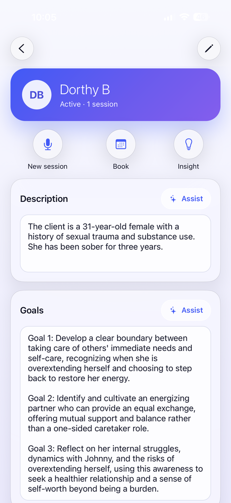

## Features

**Sessions in four steps**
1. **Start** — one button, with or without a client picked yet.
2. **Record** — large timer, a live "sliver" of the transcript so you know it's working, and the screen stays awake. If the phone locks, audio keeps saving and transcription catches up when you come back.
3. **Summary** — optionally add to the summary prompt for this session, generate, then edit the summary full screen.
4. **Note** — pick a note template, optionally add to its prompt ("include homework"), generate from your edited summary plus the transcript, edit, and save.

**Clients and calendar**
- Client list with search, active/inactive, initials, last session date.
- Client page: description and goals with AI assist, insight across the last three sessions, upcoming appointments, past sessions.
- Weekly schedule with a "today" card and one-tap **Start session**.
- **Unassigned sessions**: start recording before choosing a client; assign any time from the client chip, or when saving. Saving offers the calendar appointment the recording overlaps.
- **Automatic calendar entries**: any session with a client that isn't on the calendar gets linked to that client's overlapping appointment or a back-dated one (length corrected when you stop recording).

**Prompt engine** (Settings → Prompts)
- Note templates you can create, rename, hide, reorder and delete (built-ins: Session note, SOAP, DAP, BIRP).
- Global rules added to every prompt (e.g. "Refer to the client only as Client"), each with an on/off switch, plus rules for a single prompt.
- **See full prompt** shows exactly what the model receives.

**App**
- Glass design with blue–violet gradients, light and dark mode (System / Light / Dark switch).
- Face ID / passcode lock after a configurable time in the background.
- Encrypted database (SQLCipher) with the key in the iOS keychain.
- Over-the-air updates with a **Check for update** button in Settings.

## Screenshots

| Schedule | Clients | Client |
|---|---|---|
|  | 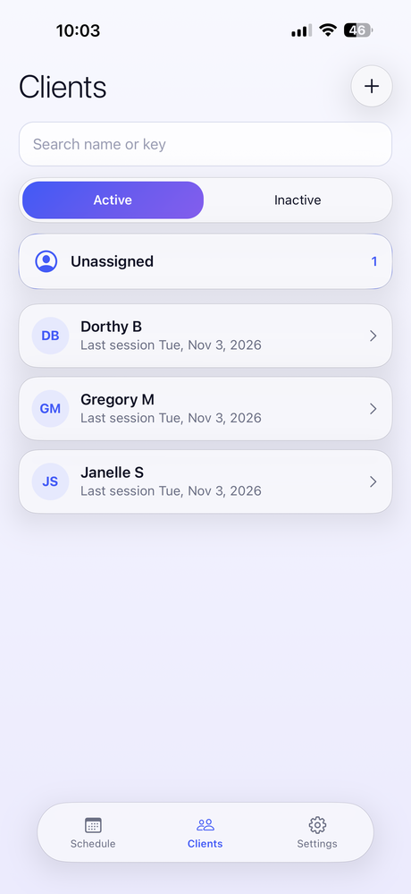 |  |

| Session ready (dark) | Recording | New appointment |
|---|---|---|
| 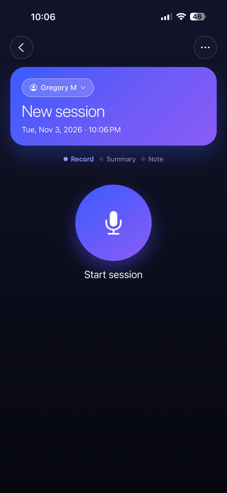 |  | 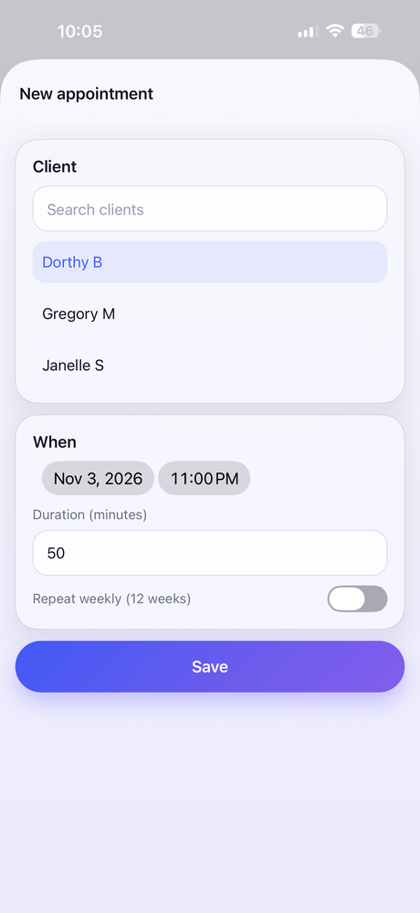 |

| Prompts hub (dark) | Prompt editor (dark) | Settings |
|---|---|---|
| 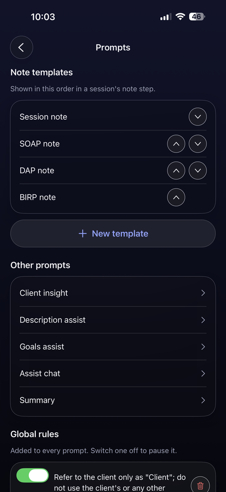 | 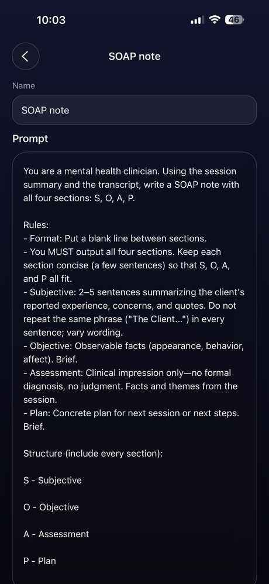 | 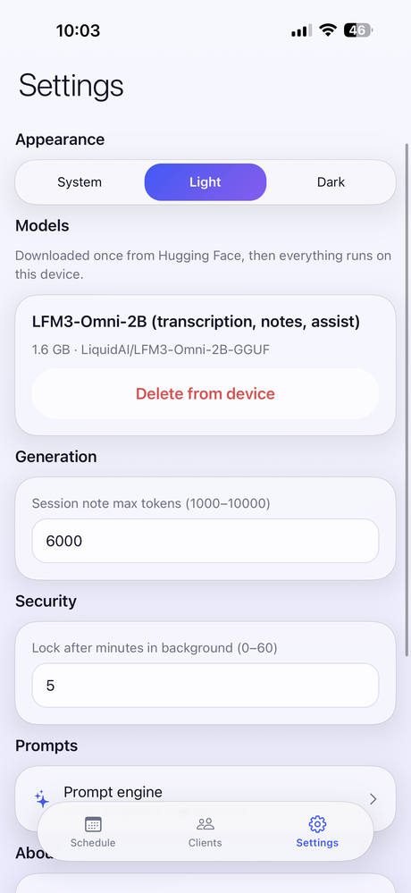 |

| Clients (dark) |
|---|
| 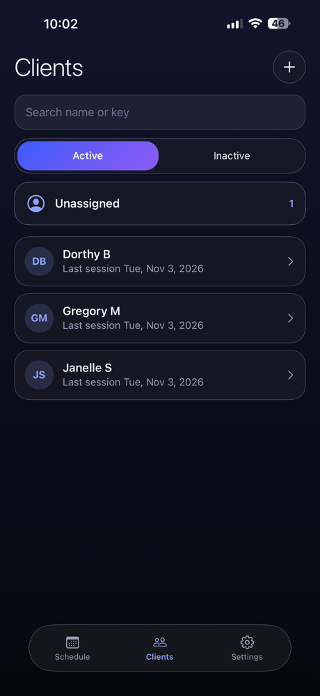 |

## How it works

| Piece | What it does |
|---|---|
| **Model** | [LiquidAI LFM3-Omni-2B](https://huggingface.co/LiquidAI/LFM3-Omni-2B-GGUF) (Q4_K_M, ~1.1 GB, plus a ~0.5 GB audio projector), downloaded once in Settings. One model does transcription, summaries, notes, assist and chat. |
| **Inference** | [llama.rn](https://github.com/mybigday/llama.rn) (llama.cpp for React Native). One job at a time; the context is sized to each job, and the audio projector loads only for transcription to save memory. Model jobs wait while the app is in the background (iOS forbids GPU work there). |
| **Audio** | `react-native-audio-api` captures the mic; a chunker cuts audio at pauses into WAV files stored per session, each transcribed as it arrives. Re-transcribe rebuilds the transcript from the saved audio. |
| **Data** | `expo-sqlite` with SQLCipher. Tables: clients, session_notes, appointments, chats, settings, prompts, rules. Column names follow SeshNotes for later import. |
| **Prompts** | A small prompt engine assembles every prompt from its text plus global and per-prompt rules, so all AI features follow the same rules. |

**Requirements:** an iPhone with enough memory for a 2B model (6 GB+ recommended; the app requests Apple's increased-memory-limit and extended-virtual-addressing entitlements). The app targets iOS; Android is not maintained.

## Privacy

- Recording, transcription and every AI step run on the device. The only network use is downloading the model from Hugging Face and fetching app updates from Expo.
- The database is encrypted; the key lives in the keychain, readable only when the phone is unlocked, and is not backed up off the device.
- The app locks with Face ID or the device passcode.
- Default prompts and rules refer to the client only as "Client".

## Credits and licences

- AI model: Liquid AI LFM3-Omni-2B, used under the LFM Open License v1.0 (full terms at [liquid.ai](https://www.liquid.ai); free, including commercial use, for companies under $10M annual revenue).
- Built with [Expo](https://expo.dev), [expo-router](https://docs.expo.dev/router/introduction/), [llama.rn](https://github.com/mybigday/llama.rn) and [react-native-audio-api](https://github.com/software-mansion/react-native-audio-api).

---

<em>This repository is a project overview. The source code is private.</em> Studio Catharsis Creative Lab

